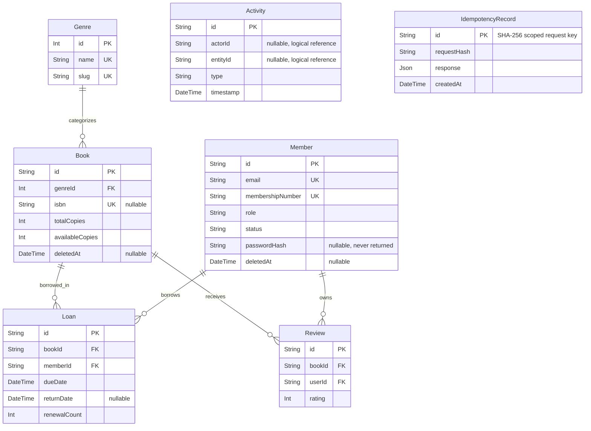

# LMBS API

NestJS 12 + Prisma 7/PostgreSQL. Run workspace commands from the repository root with `--workspace api`, or run the scripts below from this directory. HTTP and authenticated Socket.IO share port **3001**. HTTP prefix: **/api/v1**.

## Project structure

The repository is an **npm-workspaces monorepo**, not a Nest CLI monorepo. Install dependencies and use the coordinating scripts from the repository root. This README documents `apps/api`; the frontend and shared contracts live alongside it.

```text
lmbs/
├── apps/
│   ├── api/                         # NestJS backend — this directory
│   └── web/                         # React/Vite frontend
├── packages/
│   └── shared/
│       └── src/index.ts             # Shared auth, pagination and statistics types
├── tests/
│   ├── workspace.test.mjs           # Workspace and proxy-topology assertions
│   ├── api-smoke.mjs                # Opt-in isolated local HTTP acceptance
│   └── browser-smoke.mjs            # Opt-in real-browser workflows/screenshots
├── deployment/nginx.conf            # SPA, /api/v1 and Socket.IO proxy
├── docs/                            # Design, review, verification and screenshots
├── Dockerfile                       # API and web image targets
├── compose.yaml                     # PostgreSQL, migrations, private API and web
├── Installation_Guide.md            # Classroom installation and teaching steps
├── spec.md                          # Selected architecture and behavior specification
├── package.json                     # Root workspace commands
└── package-lock.json                # One dependency lockfile for all workspaces
```

Backend source layout (application code, tests and principal configuration files):

```text
apps/api/
├── prisma/
│   ├── schema.prisma               # Seven database models and their relations
│   ├── seed.ts                     # Explicit demo data / administrator bootstrap
│   └── migrations/
│       ├── 20261111085449_init/migration.sql
│       ├── 20261111100720_init/migration.sql
│       ├── 20261114120000_core_completion/migration.sql
│       └── migration_lock.toml
├── src/
│   ├── authentication/
│   │   ├── auth.controller.ts      # Registration, login and current-account routes
│   │   ├── auth.service.ts         # Account lookup and token/password workflows
│   │   ├── crypto.ts               # Scrypt and fixed-algorithm JWT verification
│   │   └── guards.ts               # Public/staff policy, authentication, throttling
│   ├── books/
│   │   ├── books.controller.ts
│   │   ├── books.service.ts
│   │   └── dto/
│   │       ├── create-book.dto.ts
│   │       └── update-book.dto.ts
│   ├── members/
│   │   ├── members.controller.ts
│   │   └── members.service.ts
│   ├── loans/
│   │   ├── loans.controller.ts
│   │   └── loans.service.ts
│   ├── genre/
│   │   ├── genre.controller.ts
│   │   └── genre.service.ts
│   ├── reviews/
│   │   ├── reviews.controller.ts
│   │   └── reviews.service.ts
│   ├── activities/activities.controller.ts  # Read-only audit collection
│   ├── stats/stats.controller.ts            # Book and circulation aggregates
│   ├── common/
│   │   ├── bootstrap.ts            # HTTP prefix, validation, CORS, proxy settings
│   │   ├── database.ts             # Transactions, retries, idempotency and audit
│   │   ├── dto.ts                  # Pagination, auth, member, loan, genre/review DTOs
│   │   ├── exception.filter.ts     # Consistent, redacted HTTP errors
│   │   ├── json.logger.ts          # Structured logging
│   │   └── mapping.ts              # Safe member/book/loan response serializers
│   ├── config/environment.ts       # Validated environment configuration
│   ├── prisma/
│   │   ├── prisma.module.ts
│   │   └── prisma.service.ts
│   ├── realtime/
│   │   ├── realtime.gateway.ts     # Authenticated Socket.IO connections/broadcasts
│   │   ├── realtime.module.ts
│   │   └── realtime.service.ts     # Post-commit invalidation events
│   ├── app.controller.ts           # Health and version endpoints
│   ├── app.module.ts               # Root provider/controller wiring
│   └── main.ts                     # Entry point; default port 3001
├── test/
│   ├── app.e2e-spec.ts             # Real PostgreSQL/HTTP/Socket.IO acceptance
│   ├── auth-config.spec.ts
│   ├── core.spec.ts
│   ├── logging.spec.ts
│   ├── proxy.spec.ts
│   ├── security.spec.ts
│   └── jest-e2e.json
├── generated/prisma/               # Generated locally; ignored by Git
├── dist/                           # Compiled application; ignored by Git
├── .env.example                    # Safe configuration template
├── package.json                    # API workspace commands/dependencies
├── prisma7.config.ts               # Schema, migrations, datasource and seed config
├── jest.config.ts
├── nest-cli.json
├── tsconfig.json
└── tsconfig.build.json
```

Feature folders group controllers/services; they do **not** each contain a separate Nest module. Root wiring is in `src/app.module.ts`; Prisma and realtime have their own modules. DTOs outside books are deliberately consolidated in `src/common/dto.ts`. See [the root README](../../README.md) for whole-application setup.

## Database schema

The source of truth is [prisma/schema.prisma](prisma/schema.prisma), with SQL-only constraints in the [completion migration](prisma/migrations/20261114120000_core_completion/migration.sql). PostgreSQL can run locally through Compose or be separately hosted; Supabase is not required for local development.

### Entity relationships



`Activity` and `IdempotencyRecord` have no declared Prisma foreign-key relations. An activity's `actorId` and `entityId` are logical identifiers, not extra ERD relationships. A review's `userId` refers to **Member.id**; there is no separate User table.

### Model summary

| Model | Primary key | Unique fields / constraints | Relationships | Purpose |
|---|---|---|---|---|
| Genre | Auto-incrementing `Int` | `name`, `slug` | One genre → many books | Catalog categories |
| Book | `String`, CUID by default | Optional `isbn` | Required genre; many loans/reviews | Catalog metadata, total/available inventory and soft deletion |
| Member | `String`, CUID by default | `email`, `membershipNumber` | Many loans/reviews | Patron/staff identity, optional login credentials and membership status |
| Loan | `String`, CUID by default | No additional unique key | Required book and member | Issue/return dates, renewal count and assessed fines |
| Activity | `String`, CUID by default | No additional unique key | Logical actor/entity IDs only | Server-generated audit history |
| Review | `String`, CUID by default | Composite `(bookId, userId)` | Required book and member | One rating/comment per member per book |
| IdempotencyRecord | Explicit `String` SHA-256 digest | Primary key scopes actor + resource + supplied key | None | Canonical request hash and durable replay response |

### Stored fields and defaults

`String?`, `Int?`, `Float?` and `DateTime?` below mean nullable **database** fields. This does not mean a write endpoint accepts explicit JSON `null`; consult its DTO/payload contract.

| Model | Stored scalar fields |
|---|---|
| Genre | `id: Int`; `name, slug: String`; `description: String?`; `createdAt, updatedAt: DateTime` |
| Book | `id, title, author: String`; `isbn: String?`; `genreId: Int`; `pages, publishedYear: Int?`; `totalCopies, availableCopies: Int` (default 3); `shelfLocation, description, coverGradient: String?`; `createdAt, updatedAt: DateTime`; `deletedAt: DateTime?` |
| Member | `id, name, email, membershipNumber: String`; `phone, passwordHash, bio, hobbies: String?`; `status: String` (default `active`); `role: String` (default `patron`); `joinedDate, createdAt, updatedAt: DateTime`; `deletedAt: DateTime?` |
| Loan | `id, bookId, memberId: String`; `borrowDate, dueDate: DateTime`; `returnDate: DateTime?`; `status: String` (default `active`); `fineAmount: Float?` (default 0); `renewalCount: Int` (default 0); `notes: String?`; `createdAt, updatedAt: DateTime` |
| Activity | `id, type, title, description: String`; `actorId, entityId: String?`; `timestamp, createdAt: DateTime` |
| Review | `id, bookId, userId: String`; `rating: Int`; `comment: String?`; `createdAt, updatedAt: DateTime` |
| IdempotencyRecord | `id, requestHash: String`; `response: Json` (PostgreSQL JSONB); `createdAt: DateTime` |

Creation timestamps default to `now()`; `updatedAt` fields use Prisma's `@updatedAt`. `Member.joinedDate`, `Loan.borrowDate` and `Activity.timestamp` also default to `now()`. A loan's due date is calculated by the service from the requested number of days, not a database default.

### Integrity and design decisions

| Decision | Rule / reason |
|---|---|
| Inventory constraints | `0 <= availableCopies <= totalCopies`; issuing/returning changes stock transactionally, not through arbitrary client stock assignments |
| Role/status fields | Stored as strings, constrained by database CHECKs and DTOs: roles `patron`, `librarian`, `admin`; member statuses `active`, `suspended`, `expired`, `inactive` |
| Review validation | Database CHECK restricts ratings to 1–5; composite uniqueness prevents duplicate member/book reviews |
| Loan state | Returned loans require a return date; stored active/overdue loans must have no return date. API overdue status/fines are derived when read |
| Restrictive foreign keys | Genre → Book, Book/Member → Loan and Book/Member → Review use `ON DELETE RESTRICT`, preserving referenced history |
| Soft deletion | Book/member rows retain `deletedAt`; deleting a member also sets `inactive`. Outstanding loans block either deletion |
| Authentication privacy | Nullable hashes support existing non-login members; safe response mapping never exposes hashes or deletion markers |
| Audit integrity | Activities are written by server-side workflows, not public create/update/delete endpoints |
| Durable retries | Idempotency rows preserve the original JSON result; the same scoped key with a different payload returns 409 |
| Legacy migration safety | Additive CHECKs are `NOT VALID`: enforced on new/updated rows without asserting all historical rows are valid. Reconcile legacy data before validating constraints |

Indexes cover book genre/title/deletion, member status/deletion, loan member/status, book/return date and due/return date, activity timestamp and idempotency creation time. Historical migration safety and transaction behavior are detailed below; this schema description is not permission to migrate a hosted database.

## Setup and commands

1. Install the root npm workspace dependencies (`npm ci`). Use the repository's supported Node version (Node 24 LTS recommended).
2. Copy `.env.example` to `.env` and supply your own PostgreSQL URL and random JWT secret. Never commit `.env`.
3. `npm run prisma:generate` generates the ignored `generated/prisma` JavaScript runtime.
4. For a new/local database: `npm run prisma:migrate:deploy`. Review every migration before applying to a populated or hosted database.
5. Optional: set `SEED_DEMO_DATA=true`, and/or explicit `SEED_ADMIN_EMAIL`, `SEED_ADMIN_PASSWORD` (12–128 characters), `SEED_ADMIN_NAME`; then `npm run prisma:seed`.
6. `npm run dev`, or `npm run build && npm run start:prod`.

Build output is `dist/main.js`. The generated runtime must remain at **apps/api/generated/prisma**, beside `dist/`, because compiled `dist/prisma/*` imports `../../generated/prisma/client`. Deployment must ship both `dist` and `generated`, plus production dependencies. `prisma:generate` is required after a clean checkout/schema change; never publish the generated client in Git.

Environment:

| Variable | Rule |
|---|---|
| DATABASE_URL | Required PostgreSQL connection URI |
| JWT_SECRET | Required unique secret, at least 32 bytes; no insecure fallback |
| PORT | Integer 1–65535; default 3001 |
| TRUST_PROXY_HOPS | 0 by default for direct/native access; Compose uses 1 only behind its private single Nginx proxy |
| JWT_EXPIRES_IN | Seconds or suffix s/m/h/d, 1 second–30 days; default 7d |
| CORS_ORIGIN | Comma-separated exact HTTP(S) origins; default localhost:5173 and localhost:3000; wildcard rejected |
| SEED_DEMO_DATA | Only literal `true` enables deterministic example data |
| SEED_ADMIN_EMAIL/PASSWORD | Both required together for optional bootstrap; never defaulted |
| SEED_ADMIN_NAME | Optional bootstrap display name |

The application fails before listening when configuration is invalid. Request bodies have a 100 KB Express default limit. Native/direct access ignores forwarded headers (`TRUST_PROXY_HOPS=0`). The supplied Compose topology does not publish the API port; Nginx overwrites X-Forwarded-For and the API explicitly trusts one hop (`1`). Never use that one-hop setting with an API reachable directly by untrusted clients. Configure an upstream distributed limiter for multi-instance deployment.

## Authorization policy

Public: book and genre reads; health/version; register/login. Registration rejects unknown fields (including role) and always writes `patron`. Every protected HTTP request checks the current database account, not a token role claim. Deleted or non-active accounts cannot authenticate.

Staff means `librarian` or `admin`. Staff-only: member/loan/activity/statistics reads; catalog/member/circulation mutations; genre mutations. No public role-promotion endpoint exists. The optional seed can create an administrator but refuses to promote an existing non-admin account.

Any active authenticated account may read `/auth/me`, `/auth/me/loans`, and CRUD **its own** reviews. Reviews are private to their owner even for staff; staff cannot modify another member's review. Review list filters never override ownership. Staff circulation reads include member names/emails; anonymous/patron collection reads are forbidden.

Password hashes are nullable for existing non-login members. Such members cannot log in and registration does not silently claim an existing email. Passwords use asynchronous Node scrypt with explicit N=32768/r=8/p=3 parameters, random 16-byte salts and constant-time key comparison. JWTs use fixed HS256 with HMAC verification, issuer/audience/expiration checks; no algorithm selection from untrusted headers and no password/hash fields in responses.

## API reference

### Base URL and common contract

- Native development: `http://localhost:3001/api/v1`.
- Supplied Compose/Nginx deployment: `http://localhost:8080/api/v1`.
- Every route in the resource tables below **already includes** `/api/v1`.

Lists return `{data,total,page,limit}`. Pagination: page >= 1, limit 1–100 (default 50). Unknown body/query fields and explicit nulls are rejected. Standard errors: `{statusCode,message,error,details}`; validation details contain messages. Prisma missing rows map to 404, duplicate/foreign-key/concurrency conflicts to 409. Internal errors are redacted.

**Access legend:** Public = no token required; Account = an active authenticated member; Staff = `librarian` or `admin`; Owner = the authenticated member who owns the review. Send `Authorization: Bearer <access_token>` on protected routes. Login/register return `{access_token,user}`. POST success is **201**; successful reads, PUT and DELETE are **200**. Delete responses are JSON messages, not 204 responses.

All JSON examples below are **illustrative response shapes**, not captured runtime output. IDs, names, tokens and dates are examples. List rows contain the same resource shape as single-resource responses:

```json
{
  "data": [],
  "total": 0,
  "page": 1,
  "limit": 50
}
```

### Authentication and current account

| Method | Route | Access | Request / query | Response |
|---|---|---|---|---|
| POST | `/api/v1/auth/register` | Public | `{name, email, password}`; password 12–128 characters | `{access_token, user}`; new patron account |
| POST | `/api/v1/auth/login` | Public | `{email, password}` | `{access_token, user}` |
| GET | `/api/v1/auth/me` | Account | — | Safe member profile |
| GET | `/api/v1/auth/me/loans` | Account | `page`, `limit` | Paginated own loans |

Emails are normalized to lowercase. Registration never accepts a privileged role or claims an existing email. Staff-created member records do not automatically have login credentials. There is no HTTP logout, role-promotion, password-reset or refresh-token endpoint; frontend logout discards the current token/session.

Illustrative authentication response (`user` is the safe member shape shown under Members):

```json
{
  "access_token": "<access_token>",
  "user": {
    "id": "member-example",
    "name": "Example Reader",
    "email": "reader@example.org",
    "phone": null,
    "membershipNumber": "LIB-EXAMPLE-001",
    "status": "active",
    "role": "patron",
    "joinedDate": "2026-11-14T12:00:00.000Z",
    "bio": null,
    "hobbies": null,
    "createdAt": "2026-11-14T12:00:00.000Z",
    "updatedAt": "2026-11-14T12:00:00.000Z"
  }
}
```

### Books

| Method | Route | Access | Request / query | Response |
|---|---|---|---|---|
| GET | `/api/v1/books` | Public | `page`, `limit`, `genre`, `available`, `search` | Paginated books |
| GET | `/api/v1/books/:id` | Public | Book ID | Book |
| POST | `/api/v1/books` | Staff | Create fields below; optional `Idempotency-Key` header | Created book |
| PUT | `/api/v1/books/:id` | Staff | Partial create fields; optional `updatedAt` version | Updated book |
| DELETE | `/api/v1/books/:id` | Staff | Book ID; rejects outstanding loans | `{"message":"Book deleted"}`; soft deletion |

Create requires `title` and `author` (trimmed, 1–200 characters). Optional fields:

| Field | Accepted value / behavior |
|---|---|
| `genre` | Name, 1–100 characters; resolved/upserted, defaults to General when neither genre selector is supplied |
| `genreId` | Existing positive integer genre ID; conflicting name/ID returns 409 |
| `isbn` | Nonblank string, 1–32 characters, unique when supplied; omit if absent |
| `pages` | Integer 0–100000 |
| `publishedYear` | Integer 0–2100 |
| `totalCopies` | Integer 0–100000; default 3 on creation |
| `availableCopies` | Integer 0–100000; must equal total copies on creation; updates cannot override checked-out inventory |
| `shelfLocation` | String up to 100 characters |
| `description` | String up to 10000 characters |
| `coverGradient` | String up to 300 characters |
| `updatedAt` | Update only: ISO timestamp captured from the last response; stale versions return 409 |

Book filters: `genre` is an exact genre name; `available` is the string `true` or `false`; `search` is a 1–200-character search term. Do not send the obsolete `copies` field or use `genreId` as a list query parameter.

Books include `_id`, string `genre`, numeric `genreId`, title,author,isbn,pages,publishedYear,totalCopies,availableCopies,shelfLocation,description,coverGradient,createdAt,updatedAt. Create title/author are required. Genre is resolved/upserted by name, defaults to General, or may use existing genreId; supplying conflicting name/ID returns 409. New books must start with all copies available. Total inventory updates preserve checked-out copies; arbitrary stock corrections are rejected. ISBN is an optional unique catalog identifier (not checksum-validated).

Illustrative book response — **books use `_id`**, unlike member/loan/review IDs:

```json
{
  "_id": "book-example",
  "title": "Example Library Handbook",
  "author": "Example Author",
  "isbn": null,
  "genreId": 1,
  "genre": "General",
  "pages": 240,
  "publishedYear": 2026,
  "totalCopies": 3,
  "availableCopies": 2,
  "shelfLocation": "A1",
  "description": "Illustrative catalog entry.",
  "coverGradient": null,
  "createdAt": "2026-11-14T12:00:00.000Z",
  "updatedAt": "2026-11-14T12:00:00.000Z"
}
```

### Genres

| Method | Route | Access | Request / query | Response |
|---|---|---|---|---|
| GET | `/api/v1/genres` | Public | `page`, `limit` | Paginated genres |
| GET | `/api/v1/genres/:id` | Public | Integer genre ID | Genre |
| POST | `/api/v1/genres` | Staff | `{name, description?}` | Created genre |
| PUT | `/api/v1/genres/:id` | Staff | `{name?, description?}` | Updated genre |
| DELETE | `/api/v1/genres/:id` | Staff | Integer ID; referenced genres return 409 | `{"message":"Genre deleted"}` |

Names are trimmed, 1–100 characters. Description is optional, up to 5000 characters. The server derives the unique slug from the name; clients cannot set `slug` directly. Genre rows are physically deleted only when foreign-key restrictions permit it.

```json
{
  "id": 1,
  "name": "General",
  "slug": "general",
  "description": null,
  "createdAt": "2026-11-14T12:00:00.000Z",
  "updatedAt": "2026-11-14T12:00:00.000Z"
}
```

### Members

| Method | Route | Access | Request / query | Response |
|---|---|---|---|---|
| GET | `/api/v1/members` | Staff | `page`, `limit`, `status` | Paginated safe member profiles |
| GET | `/api/v1/members/:id` | Staff | Member ID | Safe member profile |
| GET | `/api/v1/members/:id/loans` | Staff | `page`, `limit` | Paginated member loan history |
| POST | `/api/v1/members` | Staff | `{name, email, phone?, membershipNumber?, status?, bio?, hobbies?}` | Created member profile |
| PUT | `/api/v1/members/:id` | Staff | Partial create fields; never role/password | Updated member profile |
| DELETE | `/api/v1/members/:id` | Staff | Member ID; rejects outstanding loans | `{"message":"Member deactivated"}`; soft deletion |

Names are trimmed, 2–200 characters; email must be valid and at most 254 characters. Optional phone: up to 40 characters; membership number: trimmed 1–100 characters; bio: up to 5000; hobbies: up to 1000. Membership numbers are generated when omitted. `status` and the list status filter accept `active`, `suspended`, `expired`, `inactive`. Staff creation always creates a patron record, without a password. Password hashes and deletion markers never appear in a profile.

```json
{
  "id": "member-example",
  "name": "Example Reader",
  "email": "reader@example.org",
  "phone": null,
  "membershipNumber": "LIB-EXAMPLE-001",
  "status": "active",
  "role": "patron",
  "joinedDate": "2026-11-14T12:00:00.000Z",
  "bio": null,
  "hobbies": null,
  "createdAt": "2026-11-14T12:00:00.000Z",
  "updatedAt": "2026-11-14T12:00:00.000Z"
}
```

### Loans and circulation

| Method | Route | Access | Request / query | Response |
|---|---|---|---|---|
| GET | `/api/v1/loans` | Staff | `page`, `limit`, `status`, `bookId`, `memberId` | Paginated loans |
| GET | `/api/v1/loans/:id` | Staff | Loan ID | Loan |
| POST | `/api/v1/loans` | Staff | `{bookId, memberId, days, notes?}`; optional `Idempotency-Key` header | Issued loan |
| PUT | `/api/v1/loans/:id/return` | Staff | No body or `{}` only | Returned loan; repeat return does not restore stock twice |
| PUT | `/api/v1/loans/:id/renew` | Staff | `{days?}`; defaults to 14 | Renewed loan |

`days` must be an integer 1–365. Creation requires it; renewal defaults it when omitted. Book/member IDs are strings of 1–100 characters; optional notes are up to 5000. Loan status filters accept `active`, `overdue`, `returned`. Renewals require an eligible non-overdue/open loan and active member, and permit at most two renewals.

There is **no** generic `PUT /loans/:id` or `DELETE /loans/:id`. Clients cannot assign `status`, `dueDate`, `returnDate`, `fineAmount` or renewal counts directly. Use the issue/return/renew operations so stock and audit history remain consistent.

Loans include id,bookId,bookTitle,bookAuthor,memberId,memberName,memberEmail,borrowDate,dueDate,returnDate,status,fineAmount,notes,renewalCount. Circulation dates are UTC YYYY-MM-DD strings. Status is derived when read, so open loans become overdue without a scheduled write. Fine is **$0.50 per UTC calendar day after the due date**, calculated live for open loans and frozen on return. Return before/on due day has zero fine. Statistics include accrued open and assessed returned fines; no payment/waiver workflow is implemented. Active/overdue counts are separate; returned history remains after soft deletion.

```json
{
  "id": "loan-example",
  "bookId": "book-example",
  "memberId": "member-example",
  "borrowDate": "2026-11-14",
  "dueDate": "2026-11-28",
  "returnDate": null,
  "status": "active",
  "fineAmount": 0,
  "renewalCount": 0,
  "notes": null,
  "createdAt": "2026-11-14T12:00:00.000Z",
  "updatedAt": "2026-11-14T12:00:00.000Z",
  "bookTitle": "Example Library Handbook",
  "bookAuthor": "Example Author",
  "memberName": "Example Reader",
  "memberEmail": "reader@example.org"
}
```

### Activities / audit log

| Method | Route | Access | Request / query | Response |
|---|---|---|---|---|
| GET | `/api/v1/activities` | Staff | `page`, `limit` | Paginated activities, newest first |

There are **no** public/staff activity creation, update, single-record lookup or deletion endpoints. Application workflows write audits transactionally, including actor and entity identifiers. Activity type strings include actions such as `borrow`, `return`, `add_book`, `update_book`, `delete_book`, `add_member`, `register` and `login`; this is not an exhaustive enum.

```json
{
  "id": "activity-example",
  "actorId": "staff-example",
  "entityId": "book-example",
  "type": "add_book",
  "title": "Book added",
  "description": "add_book: book-example",
  "timestamp": "2026-11-14T12:00:00.000Z",
  "createdAt": "2026-11-14T12:00:00.000Z"
}
```

### Reviews

| Method | Route | Access | Request / query | Response |
|---|---|---|---|---|
| GET | `/api/v1/reviews` | Account | `page`, `limit`, optional `bookId` | Paginated own reviews only |
| GET | `/api/v1/reviews/:id` | Owner | Review ID | Review |
| POST | `/api/v1/reviews` | Account | `{bookId, rating, comment?}` | Created review, owned by caller |
| PUT | `/api/v1/reviews/:id` | Owner | `{rating?, comment?}` | Updated review |
| DELETE | `/api/v1/reviews/:id` | Owner | Review ID | `{"message":"Review deleted"}` |

Rating is an integer 1–5; optional comment is up to 5000 characters. `bookId` is a 1–100-character string referring to an existing nondeleted book. `userId` is taken from the authenticated identity, never the request body. Duplicate `(bookId,userId)` returns 409. Even staff cannot access or modify another member's review; a filter cannot override ownership.

```json
{
  "id": "review-example",
  "rating": 5,
  "comment": "Useful reference material.",
  "bookId": "book-example",
  "userId": "member-example",
  "createdAt": "2026-11-14T12:00:00.000Z",
  "updatedAt": "2026-11-14T12:00:00.000Z"
}
```

### Statistics

| Method | Route | Access | Request / query | Response |
|---|---|---|---|---|
| GET | `/api/v1/stats/books` | Staff | — | Book counts, stock totals and `byGenre` map |
| GET | `/api/v1/stats/loans` | Staff | — | Loan counts, accrued/assessed fines and percentage return rate |

Book statistics exclude soft-deleted books. Loan statistics retain history. `returnRate` is returned loans / total loans × 100, or 0 when there are no loans. These are unpaginated aggregate objects, not list envelopes. There are no `/books/stats` or `/loans/stats` aliases.

Book statistics shape:

```json
{
  "totalBooks": 1,
  "totalCopies": 3,
  "availableCopies": 2,
  "borrowedCopies": 1,
  "byGenre": {"General": 1}
}
```

Loan statistics shape:

```json
{
  "totalLoans": 1,
  "activeLoans": 1,
  "overdueLoans": 0,
  "totalFines": 0,
  "returnRate": 0
}
```

### Health and version

| Method | Route | Access | Request / query | Response |
|---|---|---|---|---|
| GET | `/api/v1/health` | Public | — | `{status:"ok", version:"1.0.0", database:"connected"}` after a real database query; 503 if unavailable |
| GET | `/api/v1/version` | Public | — | `{version:"1.0.0", name:"LMBS API", node:"<runtime version>"}` |

Socket.IO is a separate authenticated notification transport at `/socket.io`, not another REST resource. Connection details and event names remain in the Realtime section below.

## Transactions, retries and audits

Loan creation checks active/nondeleted member and nondeleted book, atomically decrements positive stock, inserts loan, and writes audit in one serializable transaction. Concurrent borrowers cannot oversubscribe. Returns conditionally update open loans and increment inventory only once; repeated returns return the existing result and do not write another audit. Renewals require active member, non-overdue/open loan, and at most two renewals. Mutations retry serialization failures up to five total attempts, then return 409. Catalog/member changes and review/genre writes audit transactionally with actor/entity IDs; logs do not contain request bodies, passwords, tokens, connection strings or raw DB exceptions.

Book `updatedAt` checks reject stale writes when provided. Omitting it is supported for older clients but loses optimistic conflict detection. Idempotency-Key on book/loan creation is scoped to actor+resource, printable ASCII up to 128 characters, stored durably in PostgreSQL with canonical payload hash and JSON response. Replays return the original response; altered payload returns 409. Keys are retained indefinitely (operators may design a retention policy). Realtime invalidations may repeat on a replay; clients must treat them as invalidations, not new authoritative rows.

New migrations add nullable auth fields, soft-deletion markers, indexes, review/inventory/member/loan constraints, restrictive foreign keys and idempotency storage. CHECK constraints are NOT VALID to preserve legacy invalid rows while enforcing new writes. **The two historical migrations predate this completion and include destructive schema evolution; they remain immutable.** Do not reapply their destructive SQL manually to existing databases. Back up, inspect applied migration history, reconcile legacy inventory and validate constraints before production rollout.

## Realtime

Socket.IO shares the HTTP server, path `/socket.io`; connect with `auth: {token: access_token}`. Origins are checked. Anonymous/expired/suspended identities are rejected. No client mutation/list acknowledgements exist: use HTTP for state and writes.

Server notifications: `book.created/updated/deleted`, `member.created/updated/deleted`, `loan.created/updated`. Payload envelope: `{event,payload,timestamp}`. Book events may reach all authenticated accounts; member/loan events reach only currently authorized staff. Staff join the `staff` room and account/role/token validity is rechecked before every broadcast, preventing stale privileges. Notifications emit only after commit, and are best-effort/in-process (not a durable cross-instance event bus). Always refetch HTTP state after reconnect. There is no outbox/replay delivery guarantee.

## Verification

- `npm test -- --runInBand`: validation, crypto/config, recursion and HTTP authorization tests without a database.
- `npm run build` and `npm run lint`.
- `TEST_DATABASE_URL=postgresql://...@127.0.0.1:PORT/lmbs_test npm run test:e2e -- --runInBand`: real HTTP/Socket.IO/PostgreSQL acceptance, concurrency, CRUD/RBAC, reviews, idempotency, fines/renewals, stats/audits, seeds. First deploy migrations to the same isolated test DB using an explicitly overridden DATABASE_URL.

**Integration tests clear tables.** They refuse nonlocal hosts and database names without `test`; never point them at a valuable local database or a hosted service. Missing TEST_DATABASE_URL fails rather than silently skipping tests. Tests do not read hosted `.env` credentials; explicit environment overrides take priority. Use a dedicated instance/container owned solely by the test run.

Current known deployment limits: in-memory rate limiting and best-effort notifications are single-instance; no refresh-token rotation, password-reset/email-verification, fine payment, backups automation, full-text search/tagging or report exports. TLS and operational monitoring belong at the deployment boundary. Hosted migrations/deployment are not automatically authorized.
